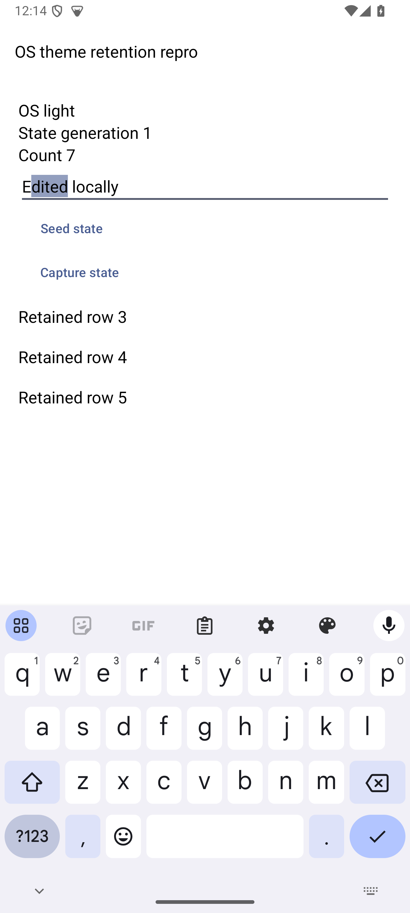
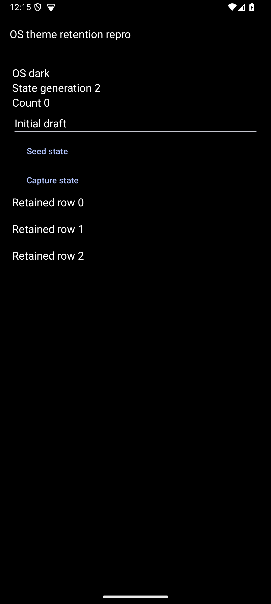
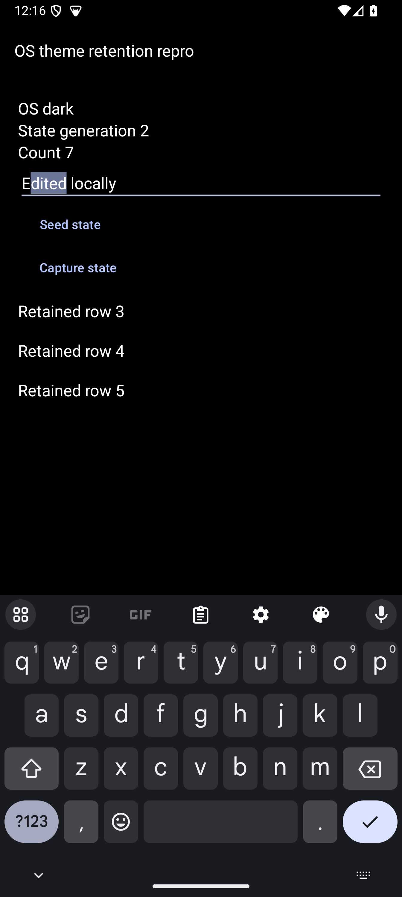
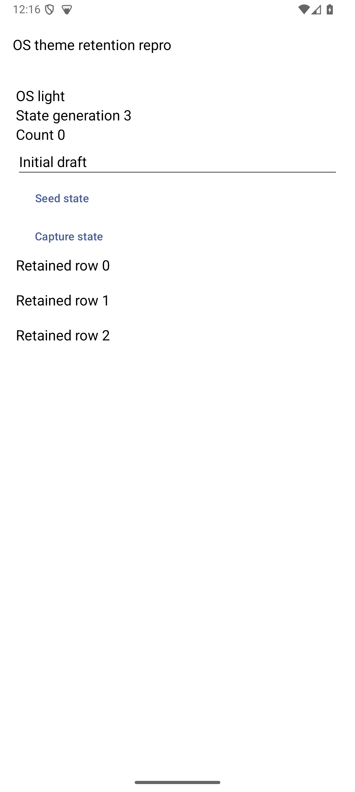

# DartNative Android OS-theme state-loss reproduction

Changing Android OS dark mode recreates the Dart `State` in this minimal app and resets its draft, counter, selection, focus and scroll. Recorded on DartNative **1.4.0**, Android **14/API 34 arm64**, debug emulator. One independently seeded transition failed in each direction. Other OS versions, devices and release builds are not qualified.

This is a complete official `dn create --platforms android --org club.orb.dntrial --project-name dn_theme_repro` scaffold with a synthetic `lib/main.dart`. The generated native Activity, Application and manifest are unchanged. There are no custom lifecycle hooks, persistence/restoration logic, Orb UI libraries or SDK binaries. The standard Gradle wrapper is included for cloning; ignore-file exceptions are the only native-directory packaging change.

## Run

Use a locally installed DartNative 1.4.0 SDK, Android toolchain and an arm64 emulator/device. The recorded SDK vendor build is `75bc07e9b49`, engine `ed0d71411e76bf9558f1c4dc8078f3222e364497`; full identifiers are in [run metadata](evidence/run-metadata.json). Invoke that SDK explicitly if Flutter is also installed. Configure a valid license locally with `dn config --license-key …`; never put a key in this repository or an issue.

From this repository:

```sh
DN_SDK=/path/to/zero
"$DN_SDK/bin/dn" --suppress-analytics pub get
adb -s ANDROID_DEVICE_ID shell cmd uimode night no
"$DN_SDK/bin/dn" --suppress-analytics run -d ANDROID_DEVICE_ID
```

Use `pub get --offline` only when all pinned dependencies are already cached. Native bindings resolve from the installed SDK through `dn pub get`; ordinary Flutter/Dart dependency resolution is not a substitute. The runner generates local SDK paths and configuration. License/configuration files, local paths, caches, build outputs and signing material are intentionally excluded.

## Reproduce

1. Set actual OS appearance to Light **before** the fresh launch above. Confirm `OS light` and `State generation 1`.
2. Record the process with `adb -s ANDROID_DEVICE_ID shell pidof club.orb.dntrial.dn_theme_repro`.
3. Tap **Seed state**, let focus/scroll settle, then **Capture state**. The recorded baseline has count 7, `Edited locally`, controller selection [1,6], focus true and scroll 120. Check the actual emitted values.
4. Set OS Dark with `adb -s ANDROID_DEVICE_ID shell cmd uimode night yes`. Do not reload, restart or reseed. Tap **Capture state** and record the PID again.
5. Observed: generation 1 was disposed and generation 2 mounted; count becomes 0, text `Initial draft`, selection [-1,-1], focus false and scroll 0. PID is unchanged.
6. Independently test the reverse direction: **Seed state** in OS Dark, settle, **Capture state**, then change OS Light with `adb -s ANDROID_DEVICE_ID shell cmd uimode night no`. Capture again without reseeding after the change. The same losses recur, now generation 2→3. This new baseline is deliberate; reseeding is not a retention pass.

Expected: OS appearance updates while preserving in-progress state, or a supported documented restoration contract preserves it. The app's manifest already handles `uiMode`. No `recreate()` suppression or skipped superclass lifecycle call is used.

## Recorded evidence

[Runtime events](evidence/android-repro-events.json) record baseline/result sequences 2→5 and 6→9. Isolate-local serials continue; State/controller identities change. Process 4392 survived both transitions. These are bounded fixture logs, not full verbose build output or native object-identity inspection.

| Light baseline | After OS Dark |
|---|---|
|  |  |

| Dark reseeded baseline | After OS Light |
|---|---|
|  |  |

Original screenshots are identified in [capture hashes](evidence/capture-manifest.json). [SDK/environment metadata](evidence/run-metadata.json) preserves exact artifact/source hashes from the measured run. [Sanitized doctor diagnostics](evidence/doctor-sanitized.txt) were collected afterward on the same SDK/host; unrelated device discovery and verbose subprocess dumps are explicitly omitted. All diagnostic categories and toolchain warnings are retained. The intentionally separate Flutter PATH and some unrelated Android SDK license warnings did not prevent the recorded debug build; commands used the explicit DN SDK path.

The public source and native host match the recorded hashes. The runner-generated local files and APK are not redistributed. The initial SDK scaffold's sample assets/icons are retained unchanged; they are not Orb artwork. No automated test here substitutes for the native lifecycle reproduction.

The publication copy separately passed dependency resolution, Dart analysis of `lib` and a fresh Android debug build on 2026-10-27. [Publication validation](evidence/publication-validation.json) distinguishes that compilation from the earlier recorded native reproduction; the lifecycle interaction was not repeated for packaging this repository.
